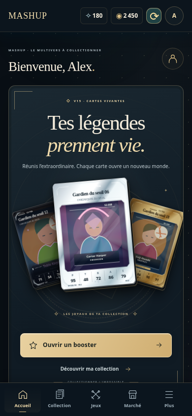
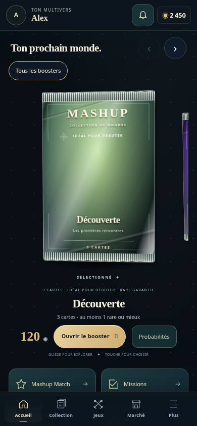

# Mashup V16.1 — proposition basée sur V15.7.2

**Branche : `feature/mashup-v16-1-social`. Aucune publication, fusion ou écriture Supabase effectuée.**

La base est `20431487acd089593603155af2c8ed75f1653f0c`, qui rétablit V15.7.2 (`79172e1`) avec le numéro technique 16.0.1 pour l’updater. Aucun fichier de l’interface V16 rejetée n’a été réintroduit. Le brouillon porte le numéro 16.1.0, état `development`, sans date de publication.

## Fonctionnel dans le client existant

- Accueil : en-tête compact avec avatar, pseudo, crédits et cloche ; boosters 3D immédiatement visibles ; prix, ouverture et bouton Probabilités ; raccourcis et journal plus bas. Défilement natif conservé. Les pépites restent dans les collections/profils.
- Probabilités : exclusivement les six taux confirmés par le serveur, somme validée ; zéro affiché à zéro ; absence de configuration signalée. Distinction explicite entre répartition de base par emplacement, redistribution des raretés indisponibles et garanties. Aucun taux fictif utilisé pour l’affichage.
- Collection : possédées/total par rareté normale, calculé sur le catalogue canonique déjà chargé ; les exemplaires ne gonflent pas le numérateur. Ajout, archivage et restauration suivent le catalogue, acquisition suit l’inventaire confirmé. Aucun total de Secrètes cachées. Séries privées exclues pour les joueurs, conservées pour l’administration.
- Notifications globales : propositions entrantes issues des échanges persistants actuels et invitations de combat ; badge, pseudo, examiner et marquer comme lu. Examiner mène au système d’échanges existant, où accepter/refuser/contre-proposer conserve ses règles. Ouvrir une notification n’accepte rien.
- Amis : recherche et filtre locaux, avatar, accès direct au défi, aux deux collections d’échange et au profil/vitrine. Les informations de vitrine sont filtrées avant affichage.
- Fiabilité : requêtes GET sociales concurrentes partagées, réponses clonées par consommateur, aucune réutilisation d’un solde ancien après écriture. Réponses d’ancien compte ignorées, notifications séparées du DOM de Match, requêtes suspendues en arrière-plan, délais réseau bornés, garde des opérations financières conservée.

Les renderers de cartes, styles de cartes existants, illustrations, catalogue canonique, moteurs Match/combats, échanges, économie et fragments backend publics sont protégés par comparaison avec la base. Les deux modules de présentation de combat/Match n’ont que leur paramètre d’import de version renouvelé.

## Ce qui nécessite encore Supabase

La présence fiable, les états lus entre appareils et l’actualisation distante des taux sans nouveau bootstrap nécessitent le petit service social décrit dans [le contrat](contracts.md). **Ils ne sont pas activés sur le backend déployé.** Sans annonce explicite de capacité, le client :

- reçoit les échanges par `/api/trades`, toutes les 45 secondes tant qu’il est visible ; récupère les demandes conservées par le serveur au retour ;
- garde la lecture sur cet appareil seulement et le dit dans l’interface ; un autre appareil retrouve la proposition mais peut encore la considérer non lue ;
- affiche « Présence indisponible » ; aucun point vert déduit du simple fait de posséder un compte ;
- affiche les taux du dernier bootstrap/sauvegarde admin confirmé, avec indication de fraîcheur ; ne promet pas leur actualisation distante immédiate.

Le service préparatoire et son gabarit de migration sont conservés **hors du dépôt public**, dans `/workspace/mashup-backend-private/social-v161`. Il s’agit de code nouveau, pas des sources exactes déployées. Aucun accès Supabase officiel OAuth/get_edge_function ni CLI authentifié n’est disponible dans cette session. Le repository Postgres, l’intégration au vrai routeur/JWT, les politiques Realtime, les sauvegardes/restaurations et les tests de préproduction restent à effectuer. Le gabarit SQL n’a pas été appliqué ni validé par restauration.

Pour débloquer : connecter le MCP Supabase officiel par OAuth au seul projet `lxpgdhwfxeicuofycqup`, d’abord en lecture seule ; télécharger et empreinter les sources actuelles de `mashup-api-gh` et `mashup-games` ; vérifier le mapping identité → compte ; tester l’ajout isolé sur une préproduction fictive. Ne fournir aucune clé secrète dans le chat ou GitHub.

## Preuves

- **417/417 tests Node réussis**, dont 26 nouveaux tests V16.1 : [journal complet](artifacts/unit-results.txt).
- **11 scénarios navigateur** : [résultat](artifacts/browser-results.json), cinq formats d’accueil 320×568, 360×740, 390×844, 430×932 et 1280×800.
- **15 parcours de régression** : [résultat](artifacts/regression-results.json), campagnes simple/double sur trois tailles, PvP hôte/invité, confidentialité, résultats, choix d’échange, contre-offres, déconnexion, préférences et onglets.
- **5 scénarios d’interruption** : [résultat](artifacts/booster-update-results.json), confirmation perdue/reprise sans deuxième préparation, annulation, Mémoire, mise à jour différée pendant combat/achat et conservation du stockage Auth fictif.
- **9 scénarios sociaux à deux comptes et trois contextes navigateur** : [résultat](artifacts/social-integration-results.json), envoi depuis les collections, réception pendant Match, lecture sur deuxième appareil, panne/reprise, invitation de combat, changement des taux sans catalogue et expiration d’une présence. Ils utilisent le service privé **en mémoire**, pas Supabase.
- **8 tests privés de sécurité de ce service fictif** : [journal](artifacts/private-security-results.txt), identité vérifiée, interdiction d’acteur/crédits fournis par le client, destinataire autorisé, bail, séquences désordonnées, rollback d’une panne et absence d’informations privées dans la réponse.

Chromium 155 Linux, Playwright 1.64.1, dimensions/tactile simulés. **Aucun téléphone Android/iPhone physique, Safari, réseau mobile ni Edge Function déployée testé.** Toutes les requêtes externes des parcours sont interceptées ; identités/inventaires/crédits fictifs. Le succès des simulations ne valide pas la sécurité ou les transactions de production.

| Accueil V15.7.2 | Accueil V16.1 |
| --- | --- |
|  |  |

Autres captures : [petit écran 320](artifacts/home-320.png), [ordinateur](artifacts/home-1280.png), [progression](artifacts/collection-390.png), [taux](artifacts/odds.png), [notification](artifacts/two-accounts-inbox.png), [présence expirée simulée](artifacts/presence-expired.png), [échanges existants](artifacts/trades-collections-mobile.png).

Vidéos du vrai rendu navigateur avec données fictives : [ouverture et reprise](artifacts/booster-interruptions-preview.webm), [combat](artifacts/combat-preview.webm).

Les [mesures de performance et de réseau](validation.md) détaillent les gains, les coûts supplémentaires et les limites. Les commandes de reproduction sont dans ce même document.

## Conditions avant publication

1. Relire et approuver la branche/PR ; aucun déploiement automatique inclus.
2. Vérifier ce client avec l’API réelle sur une préproduction indépendante et deux comptes fictifs, sans copier les joueurs.
3. Si la présence et les lectures entre appareils sont exigées pour la sortie V16.1, terminer et vérifier leur service privé avant de l’annoncer au bootstrap. Ne pas présenter ces garanties comme livrées en production à ce stade.
4. Essayer au moins un des Android ayant échoué avec V16, un iPhone/Safari et le mode installé ; contrôler les zones tactiles, le défilement, la reprise et la reconnexion.
5. Vérifier les taux réels après modification admin et les quantités de catalogue après ajout/archive/restauration ; contrôler la confidentialité depuis un compte joueur.
6. Relever les requêtes réelles et les volumes compressés/CDN/Supabase ; les mesures locales ne les remplacent pas.
7. Préparer une version de retour arrière au numéro supérieur pour l’updater. Le retour arrière ne nécessite aucune modification d’inventaire, de compte ou de crédit.
